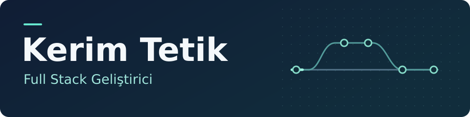

Bilgisayar mühendisiyim. Java ve C# ile REST API’leri, React ile bu servisleri kullanan arayüzler geliştiriyorum. İnönü Üniversitesinde Yazılım Mühendisliği alanında yüksek lisans yapıyor, Yeşilyurt Halk Eğitim Merkezinde Python ve internet programlama dersleri veriyorum.

[Portfolyo](https://www.kerimtetik.com/) · [LinkedIn](https://www.linkedin.com/in/kerim-tetik-708168221/) · [E-posta](mailto:abdulkerimtetik0@gmail.com)

## Seçili projeler

| Proje | Ne yapıyor? |
| --- | --- |
| **[KayraExportCase](https://github.com/kerimtetik/KayraExportCase)** | Kimlik doğrulama, ürün ve günlük kaydı işlevlerini üç .NET 8 servisine ayırıyor. İstekleri YARP üzerinden ilgili servise yönlendiriyor. |
| **[Gözlük e-ticaret sitesi](https://github.com/kerimtetik/eticaret)** | Spring Boot ve PostgreSQL ile ürün kataloğu, e-posta doğrulaması, alışveriş sepeti ve yönetici paneli sunuyor. |
| **[Femur boyun açısı ölçüm aracı](https://github.com/kerimtetik/Femur-Boyun-Acisi-Bulma)** | Pelvis röntgenlerinde kemik bölgesini ayırıp femur boyun açısını Python ile hesaplıyor. Komut satırından veya Jupyter üzerinden kullanılabiliyor. |
| **[Kişisel portfolyo](https://github.com/kerimtetik/portfolyo)** | Projelerimi ve deneyimlerimi Türkçe ve İngilizce sunan React uygulaması. Arayüzde Tailwind CSS ve Framer Motion kullandım. |

## Deneyim

- **Yeşilyurt Halk Eğitim Merkezi · Yazılım Eğitmeni** — Eylül 2026’dan bu yana Python ve internet programlama dersleri veriyorum.
- **İnönü Üniversitesi Dijital Dönüşüm Ofisi · Full Stack Geliştirici Stajyeri** — Eylül 2025 – Ocak 2026 arasında Spring Boot servisleri ve React yönetim panelleri geliştirdim. PostgreSQL veri modelleri ve rol bazlı erişim denetimi üzerinde çalıştım.
- **Kawien AI · Backend Geliştirici Stajyeri** — Haziran – Eylül 2025 arasında doğal dil işleme modellerini REST servislerine entegre ettim. Metni modele hazırlayan ve model yanıtını uygulamaya ileten akışlar geliştirdim.

## Kullandığım teknolojiler

| Alan | Teknolojiler |
| --- | --- |
| Backend | Java, Spring Boot, C#, .NET 8, Python |
| Frontend | React, JavaScript, Material UI, HTML, CSS |
| Veri ve doğal dil işleme | PostgreSQL, SQL, Hugging Face, NLTK, TensorFlow |
| Geliştirme araçları | Git, Docker, Postman, Swagger |
